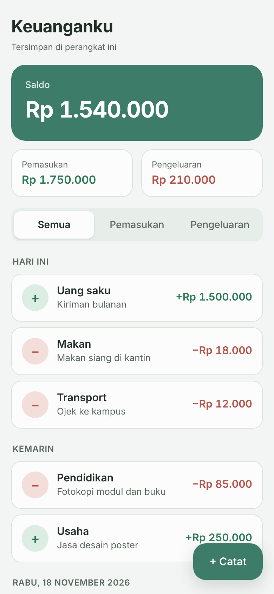
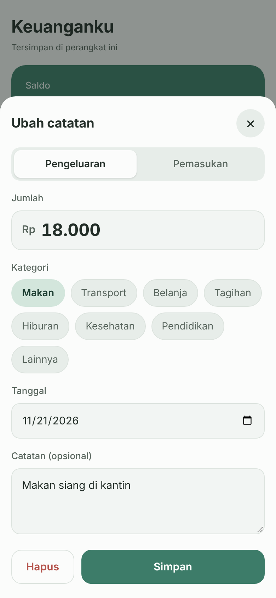
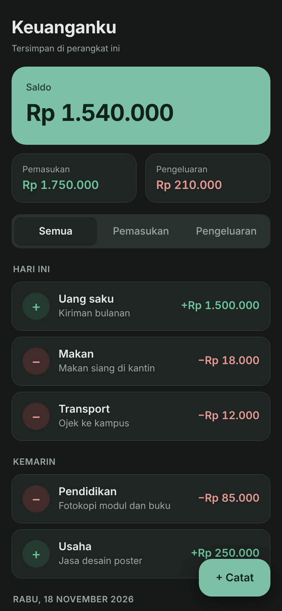

<p align="center">
  
</p>

<h1 align="center">Keuanganku</h1>

<p align="center">
  Pencatat pemasukan dan pengeluaran pribadi.<br>
  Simpel, nyaman di mata, dan datanya tersimpan di perangkatmu sendiri.
</p>

<p align="center">
  <a href="https://github.com/ArsComputer/KeuangankuRN/releases"><b>Unduh APK</b></a>
  &nbsp;·&nbsp;
  <a href="https://arscomputer.github.io/KeuangankuRN/"><b>Coba versi web</b></a>
</p>

<p align="center">
  
  &nbsp;
  
  &nbsp;
  
</p>
<p align="center"><sub>Screenshot dari versi web. Data hanya contoh.</sub></p>

## Fitur

- **Catat, ubah, hapus, dan lihat** pemasukan maupun pengeluaran.
- **Catatan** di setiap transaksi, misalnya "makan siang di kantin".
- **Kategori** siap pakai. Pengeluaran: Makan, Transport, Belanja, Tagihan, Hiburan, Kesehatan, Pendidikan, Lainnya. Pemasukan: Uang saku, Gaji, Bonus, Usaha, Lainnya.
- **Ringkasan** saldo, total pemasukan, dan total pengeluaran di bagian atas.
- **Filter** daftar: Semua, Pemasukan, atau Pengeluaran.
- **Pilih tanggal** transaksi. Di versi web, daftar juga dikelompokkan per hari (Hari ini, Kemarin, dan seterusnya).
- **Jumlah otomatis berformat** rupiah dengan titik ribuan saat mengetik (`1500000` menjadi `1.500.000`).
- **Konfirmasi sebelum hapus**, supaya tidak terhapus tanpa sengaja.
- **Tema lembut** hijau sage yang tidak menyilaukan, otomatis mengikuti mode terang atau gelap di HP.
- **Tanpa internet dan tanpa akun.** Semua data ada di perangkatmu.

## Dua versi dalam satu repo

| | Aplikasi Android | Versi web |
|---|---|---|
| Berkas | `App.js` (React Native / Expo) | `index.html` |
| Cara pakai | Pasang file `.apk` | Buka link di browser |
| Penyimpanan | Memori aplikasi (AsyncStorage) | Browser (localStorage) |

Data kedua versi **terpisah**. Catatan di aplikasi tidak otomatis muncul di versi web, dan sebaliknya.

## Memasang aplikasi di HP

1. Buka halaman [**Releases**](https://github.com/ArsComputer/KeuangankuRN/releases) dari HP.
2. Unduh file `Keuanganku-vX.Y.Z.apk` dari rilis terbaru.
3. Buka file yang diunduh. Kalau muncul peringatan **Install dari sumber tidak dikenal**, izinkan untuk browser atau pengelola file yang kamu pakai.
4. Ketuk **Install**, lalu buka **Keuanganku**.

> APK ini ditandatangani dengan kunci bawaan (debug), jadi cocok untuk dipakai pribadi tetapi belum disiapkan untuk Google Play.

### Versi web di layar utama

Buka [link versi web](https://arscomputer.github.io/KeuangankuRN/) di Chrome HP, lalu pilih menu ⋮ → **Tambahkan ke layar utama**. Ikonnya muncul seperti aplikasi biasa.

## Build APK otomatis (GitHub Actions)

Workflow [`build-apk.yml`](.github/workflows/build-apk.yml) merakit APK di server GitHub lalu menerbitkannya ke Releases. Tidak perlu akun Expo dan tidak perlu secret apa pun.

**Lewat tombol (bisa dari HP):**
1. Buka tab **Actions** → **Build APK** → **Run workflow**.
2. Isi nama rilis, misalnya `v1.0.1`, lalu jalankan.
3. Tunggu sekitar 10 sampai 20 menit. APK muncul di tab **Releases**.

**Lewat tag:**
```bash
git tag v1.0.1
git push origin v1.0.1
```

Setiap nama rilis (tag) hanya bisa dipakai sekali untuk rilis baru. Kalau dijalankan lagi dengan nama yang sama, APK di rilis itu diganti.

## Menjalankan untuk pengembangan

Butuh [Node.js](https://nodejs.org) versi LTS.

```bash
git clone https://github.com/ArsComputer/KeuangankuRN.git
cd KeuangankuRN
npm install
npx expo install --fix
npx expo start
```

Pindai kode QR yang muncul memakai aplikasi **Expo Go** di HP (Android dan laptop harus satu jaringan Wi-Fi).

Tanpa laptop, kamu bisa menempel isi `App.js` ke [snack.expo.dev](https://snack.expo.dev) lalu membukanya lewat Expo Go.

### Build lewat Expo (EAS), alternatif

Berkas `eas.json` sudah menyediakan profil `preview` yang menghasilkan APK.

```bash
npm install -g eas-cli
eas login
eas build -p android --profile preview
```

## Struktur proyek

```
.
├── App.js                      Seluruh aplikasi React Native
├── app.json                    Pengaturan Expo (nama, ikon, paket Android)
├── package.json                Daftar paket
├── eas.json                    Profil build EAS
├── index.html                  Versi web (satu berkas)
├── manifest.webmanifest        Agar versi web bisa dipasang ke layar utama
├── favicon.svg, icon-*.png     Ikon versi web
├── apple-touch-icon.png
├── assets/                     Ikon aplikasi Android
├── docs/                       Screenshot untuk README
└── .github/workflows/
    └── build-apk.yml           Build APK otomatis
```

## Teknologi

- [React Native](https://reactnative.dev) dan [Expo](https://expo.dev)
- [AsyncStorage](https://react-native-async-storage.github.io/async-storage/) untuk penyimpanan di perangkat
- HTML, CSS, dan JavaScript biasa untuk versi web
- GitHub Actions dan GitHub Pages untuk build dan hosting

## Catatan penting

- Karena data hanya ada di perangkat, **menghapus data aplikasi atau data browser berarti menghapus catatanmu**. Belum ada fitur cadangan atau ekspor.
- Satu catatan hanya bisa berupa pemasukan atau pengeluaran. Jenisnya bisa diubah saat mengedit.
- Jumlah dibatasi sampai 12 digit.
